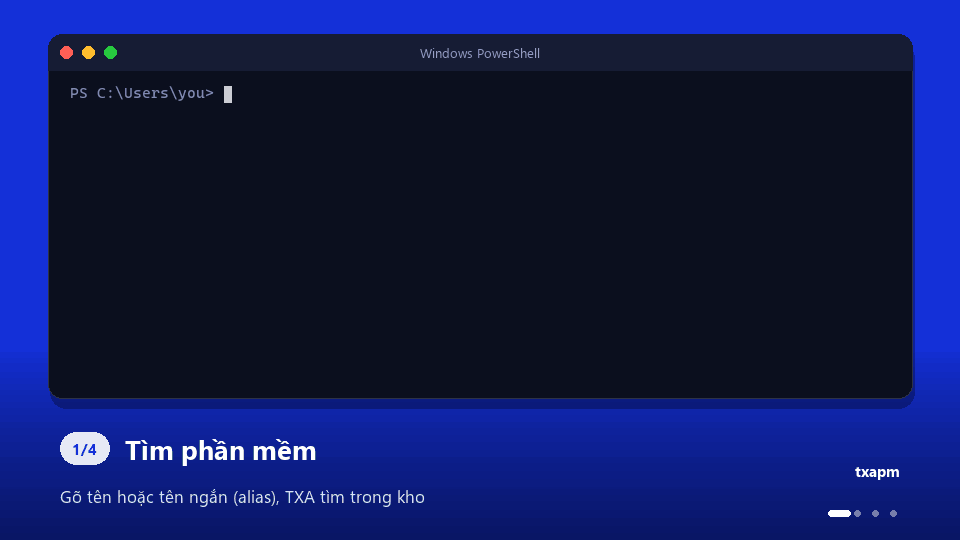
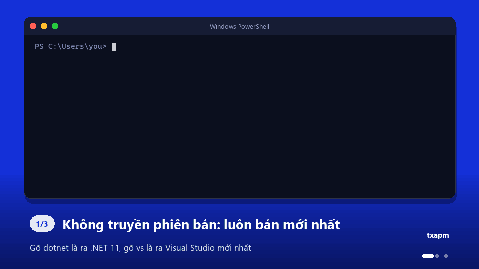
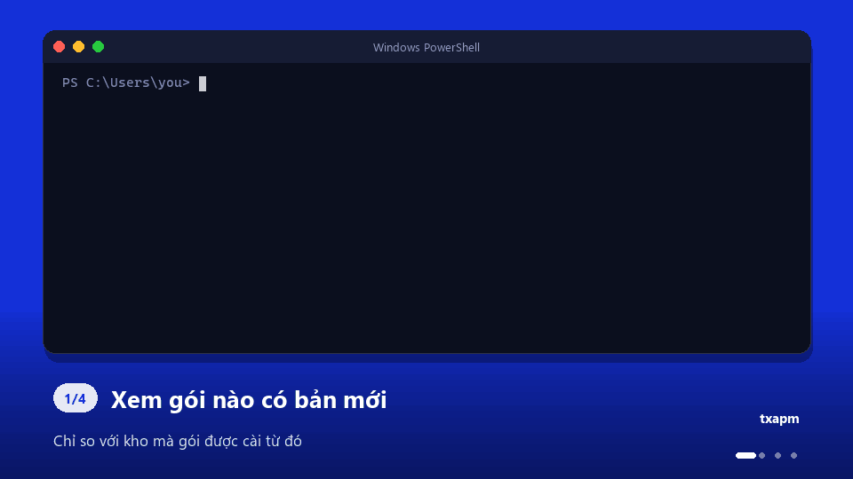
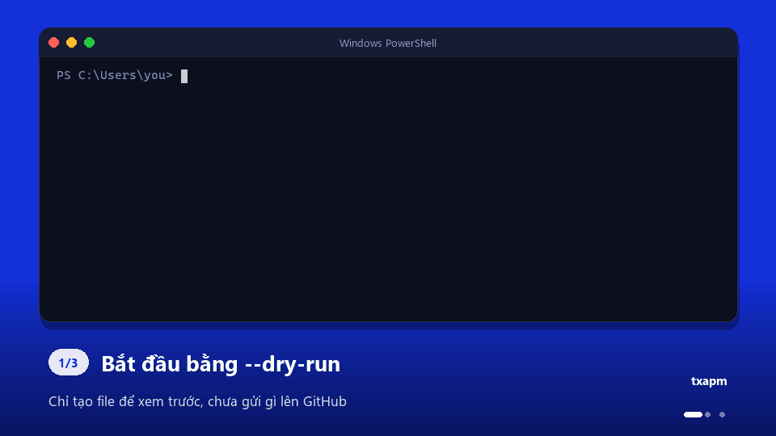

# TXA

**Cài phần mềm Windows bằng một dòng lệnh.** TXA tải bộ cài trực tiếp từ trang chính thức của nhà phát hành,
kiểm tra **chữ ký số và mã SHA-256**, rồi cài **im lặng**: không phải bấm Next, và TXA
không lưu lại bộ cài của ai.

```powershell
txapm install vlc
```

[](https://pypi.org/project/txa/)
[](https://github.com/TXAVL/txa-repo/releases)

<p align="center">
  
</p>

## Vì sao dùng TXA

- **Gõ ngắn, nhớ dễ.** Mỗi gói có tên ngắn (alias): `txapm install vscode`, `git`, `7zip`, `dotnet`, `vs`…
  Không truyền phiên bản thì luôn lấy **bản mới nhất**; muốn bản cũ thì `--version 8` hoặc `--version 17.10`.
- **An toàn theo mặc định.** Mỗi gói chỉ trỏ tới link tải chính thức, qua bot kiểm định 16 bước và có người duyệt
  trước khi vào kho. Lệch một byte so với mã SHA-256 là TXA xoá file và dừng.
- **Gói portable không cần quyền admin.** Giải nén vào thư mục của riêng bạn và tự thêm vào PATH (FFmpeg, …).
- **Mang cả bộ phần mềm sang máy mới.** `txapm export` rồi `txapm import`.
- **Có cầu nối WinGet.** Chưa có trong kho TXA thì `txapm wg install <id>` lấy từ WinGet, vẫn kiểm tra SHA-256.
- **Kho riêng của bạn.** `txapm source add` thêm kho công ty hoặc thư mục trên ổ mạng, xem
  [Kho nguồn riêng trên trang Docs](https://txavl.github.io/txa-repo/docs/#kho-nguon).

---

## Cài đặt

Yêu cầu: Windows 10 (1809) trở lên, x64 hoặc ARM64.

### Cách 1 — PowerShell (không cần Python)

Mở PowerShell (không cần quyền admin) và chạy:

```powershell
irm https://raw.githubusercontent.com/TXAVL/txa-repo/main/install.ps1 | iex
```

Script tải bản mới nhất, kiểm tra SHA-256, cài vào `%LOCALAPPDATA%\TXA` và tự thêm vào PATH.
Mở cửa sổ terminal mới là dùng được.

Script **hỏi ngôn ngữ trước khi bắt đầu cài** (English / Tiếng Việt, Enter = theo ngôn ngữ Windows) và in mọi
thông báo, bảng lệnh bằng ngôn ngữ đã chọn. Bỏ qua câu hỏi (cài tự động) bằng `-Lang en` / `-Lang vi` hoặc biến `TXA_LANG`:

```powershell
& ([scriptblock]::Create((irm https://raw.githubusercontent.com/TXAVL/txa-repo/main/install.ps1))) -Lang vi
```

### Cách 2 — pipx (nếu đã có Python 3.10+)

```powershell
pipx install txa
```

Chưa có pipx thì chạy `python -m pip install --user pipx` rồi `python -m pipx ensurepath`, sau đó mở terminal mới.

### Thử ngay

```powershell
txapm --version
txapm search vlc
txapm install vlc
```

Nâng cấp chính TXA: cài bằng PowerShell thì chạy lại lệnh ở Cách 1, cài bằng pipx thì `pipx upgrade txa`.

---

## Xem thử

<table>
  <tr>
    <td width="50%"><br /><sub><b>Chọn đúng phiên bản.</b> Không truyền thì lấy bản mới nhất; <code>--version 17.10</code> lấy bản 17.10.x mới nhất.</sub></td>
    <td width="50%"><br /><sub><b>Nâng cấp và sao lưu.</b> <code>upgrade</code>, <code>export</code>, <code>import</code> cả bộ phần mềm.</sub></td>
  </tr>
</table>

---

## Dùng `txapm`

Gói nào có tên ngắn (alias) thì gõ tên ngắn cũng được, ví dụ `txapm install hellotool`.
Một số lệnh có tên viết tắt: `add` = install, `rm` = uninstall, `ls` = list, `find` = search.

### Tìm và cài

| Muốn làm gì | Lệnh |
|---|---|
| Tìm phần mềm | `txapm search notepad` |
| Xem thông tin một gói | `txapm show TXAVL.HelloTool` |
| Xem các phiên bản trong kho | `txapm show TXAVL.HelloTool --versions` (kèm CPU/ngôn ngữ, đánh dấu bản mới nhất và bản đã cài) |
| Cài bản mới nhất | `txapm install TXAVL.HelloTool` |
| Cài một phiên bản cụ thể | `txapm install TXAVL.HelloTool --version 1.4.2` |
| Cài bản mới nhất của một dòng phiên bản | `txapm install dotnet-sdk-8 --version 8` · `txapm install vs2022 --version 17.10` |
| Chọn phiên bản từ danh sách trong kho | `txapm install TXAVL.HelloTool --choose` |
| Cài nhưng vẫn xem tiến trình | `txapm install TXAVL.HelloTool --progress` |
| Cài với giao diện gốc của bộ cài | `txapm install TXAVL.HelloTool --interactive` |
| Không tạo shortcut ngoài desktop mà gói khai báo | `txapm install TXAVL.HelloTool --no-shortcut` |
| Chỉ tải về, không cài | `txapm install TXAVL.HelloTool --download-only` |
| Tải bộ cài và manifest về thư mục (mặc định Downloads) | `txapm download TXAVL.HelloTool -d D:\setup` |
| Thử một manifest trên máy trước khi gửi | `txapm install --manifest <thư-mục>` |

### Quản lý phần mềm đã cài

| Muốn làm gì | Lệnh |
|---|---|
| Xem gói đã cài | `txapm list` |
| Xem gói có bản mới | `txapm list --upgrade-available` |
| Xem **mọi** phần mềm trên máy, đánh dấu cái nào có trong TXA | `txapm list --all` |
| Nâng cấp một gói / tất cả | `txapm upgrade TXAVL.HelloTool` · `txapm upgrade --all` |
| Giữ nguyên phiên bản, không cho `upgrade --all` đụng vào | `txapm pin add TXAVL.HelloTool` |
| Bỏ giữ / xem danh sách đang giữ | `txapm pin remove TXAVL.HelloTool` · `txapm pin list` |
| Gỡ cài đặt | `txapm uninstall TXAVL.HelloTool` |
| Xem vị trí cài, PATH và nguồn của một gói | `txapm which <tên-gói>` (thêm `--json` cho ứng dụng đọc, xem [Tích hợp ứng dụng trên trang Docs](https://txavl.github.io/txa-repo/docs/app-integration/)) |

### Sao lưu và chuyển máy

| Muốn làm gì | Lệnh |
|---|---|
| Sao lưu danh sách gói | `txapm export pkgs.json` |
| Cài lại cả bộ trên máy mới | `txapm import pkgs.json` (thêm `--exact-versions` để cài đúng phiên bản đã xuất) |

### Kho nguồn và WinGet

| Muốn làm gì | Lệnh |
|---|---|
| Xem / thêm các kho nguồn | `txapm source` · xem [Kho nguồn riêng trên trang Docs](https://txavl.github.io/txa-repo/docs/#kho-nguon) |
| Tìm / cài trực tiếp gói từ WinGet qua `txapm` | `txapm wg search <từ-khóa>` · `txapm wg install <id>` |

### Chẩn đoán và dọn dẹp

| Muốn làm gì | Lệnh |
|---|---|
| Kiểm tra sức khỏe hệ thống, kho nguồn, WinGet và cache | `txapm doctor` |
| Dọn bộ cài tải tạm và file log cài đặt | `txapm clean` · `txapm clean --all` |
| Xem danh sách hoặc đọc nội dung log cài đặt | `txapm log` · `txapm log <tên-gói>` |
| Thông tin cài đặt, đường dẫn, tài khoản | `txapm --info` |

---

## Phần mềm có sẵn trong kho

Bảng dưới là các gói đang có trong kho, chia theo nhóm; bấm vào từng nhóm để mở. **Không ghi số phiên bản** vì
kho tự cập nhật nhiều lần mỗi ngày: xem bản mới nhất bằng `txapm show <gói>` hoặc trên
[trang chỉ mục](https://txavl.github.io/txa-repo/), cũng là nơi tìm kiếm toàn bộ kho.

<details>
<summary><b>Dev & CLI</b> (46 gói)</summary>

| Phần mềm | Cài bằng |
|---|---|
| Git | `txapm install git` |
| GitHub CLI | `txapm install gh` |
| GitHub Desktop | `txapm install github-desktop` |
| Python | `txapm install python` |
| Node.js | `txapm install nodejs` (cũng gõ được: `node`, `npm`, `npx`) |
| NVM for Windows | `txapm install nvm` (cũng gõ được: `nvm-windows`) |
| Go | `txapm install go` |
| Rustup: the Rust toolchain installer | `txapm install rustup` |
| CMake | `txapm install cmake` |
| MSYS2 | `txapm install msys2` |
| Oh My Posh | `txapm install ohmyposh` |
| Neovim | `txapm install nvim` |
| Notepad++ | `txapm install notepadpp` |
| Sublime Text 4 | `txapm install sublimetext4` |
| Microsoft Visual Studio Code | `txapm install vscode` |
| Visual Studio Community 2026 | `txapm install vs18-community` (cũng gõ được: `vs`, `visualstudio`, `vs2026`) |
| Visual Studio Community 2022 | `txapm install vs17-community` (cũng gõ được: `vs2022`, `vs2022-community`) |
| Visual Studio Community 2019 | `txapm install vs16-community` (cũng gõ được: `vs2019`, `vs2019-community`) |
| Microsoft .NET SDK 11.0 | `txapm install dotnet-sdk-11` (cũng gõ được: `dotnet`, `dotnet-sdk`) |
| Microsoft .NET SDK | `txapm install dotnet-sdk-10` |
| Microsoft .NET SDK 9.0 | `txapm install dotnet-sdk-9` |
| Microsoft .NET SDK 8.0 | `txapm install dotnet-sdk-8` |
| Microsoft .NET SDK 7.0 | `txapm install dotnet-sdk-7` |
| Microsoft .NET SDK 6.0 | `txapm install dotnet-sdk-6` |
| Microsoft .NET Windows Desktop Runtime | `txapm install dotnet-desktop-8` |
| Microsoft Build of OpenJDK 17 | `txapm install openjdk` |
| Update Watcher for AdoptOpenJDK | `txapm install ajupdatewatcher` |
| NSIS | `txapm install nsis` |
| Postman | `txapm install postman` |
| DBeaver | `txapm install dbeaver` |
| Docker Desktop | `txapm install docker` |
| QEMU | `txapm install qemu` |
| QEMU Guest Agent | `txapm install qemuguestagent` |
| cloudflared | `txapm install cloudflared` |
| JetBrains Toolbox | `txapm install jetbrains-toolbox` |
| PuTTY | `txapm install putty` |
| WinSCP | `txapm install winscp` |
| Wireshark | `txapm install wireshark` |
| Antigravity 2.0 | `txapm install antigravity` (cũng gõ được: `agy`, `agy2`) |
| Antigravity IDE | `txapm install antigravityide` |
| OpenAI Codex | `txapm install codex` |
| Claude | `txapm install claude` |
| AutoHotkey | `txapm install ahk` |
| Unity Hub | `txapm install unity` |
| Unity Hub | `txapm install unityhub` |
| T-Drop | `txapm install tdrop` |

</details>

<details>
<summary><b>Trình duyệt, mạng & liên lạc</b> (21 gói)</summary>

| Phần mềm | Cài bằng |
|---|---|
| Google Chrome | `txapm install chrome` |
| Cốc Cốc | `txapm install coccoc` |
| Cốc Cốc Beta | `txapm install coccoc-beta` (cũng gõ được: `coccocbeta`) |
| Mozilla Firefox | `txapm install firefox` |
| Microsoft Edge | `txapm install edge` |
| Brave | `txapm install brave` |
| Mozilla Thunderbird | `txapm install thunderbird` |
| qBittorrent | `txapm install qbittorrent` |
| AnyDesk | `txapm install anydesk` |
| TeamViewer | `txapm install teamviewer` |
| LocalSend | `txapm install localsend` |
| Discord | `txapm install discord` |
| Slack | `txapm install slack` |
| Zoom Workplace | `txapm install zoom` |
| Telegram Desktop | `txapm install telegram` |
| Signal | `txapm install signal` |
| Zalo | `txapm install zalo` |
| Google Drive | `txapm install google-drive` |
| Microsoft OneDrive | `txapm install onedrive` |
| Bitwarden | `txapm install bitwarden` |
| KeePassXC | `txapm install keepassxc` |

</details>

<details>
<summary><b>Đa phương tiện & đồ họa</b> (14 gói)</summary>

| Phần mềm | Cài bằng |
|---|---|
| VLC media player | `txapm install vlc` |
| FFmpeg | `txapm install ffmpeg` (cũng gõ được: `ffprobe`, `ffplay`) |
| OBS Studio | `txapm install obs` |
| ShareX | `txapm install sharex` |
| Audacity | `txapm install audacity` |
| HandBrake | `txapm install handbrake` |
| CapCut | `txapm install capcut` |
| Spotify | `txapm install spotify` |
| GIMP | `txapm install gimp` |
| Inkscape | `txapm install inkscape` |
| Krita | `txapm install krita` |
| Blender | `txapm install blender` |
| FastStone Image Viewer | `txapm install fsviewer` |
| SumatraPDF | `txapm install sumatrapdf` |

</details>

<details>
<summary><b>Tiện ích hệ thống & tiếng Việt</b> (19 gói)</summary>

| Phần mềm | Cài bằng |
|---|---|
| 7-Zip | `txapm install 7zip` |
| WinRAR | `txapm install winrar` |
| PeaZip | `txapm install peazip` |
| PowerToys | `txapm install powertoys` |
| Everything | `txapm install everything` |
| WinDirStat | `txapm install windirstat` |
| TreeSize Free | `txapm install treesizefree` |
| CPU-Z | `txapm install cpu-z` |
| HWiNFO | `txapm install hwinfo` |
| CrystalDiskInfo | `txapm install crystaldiskinfo` |
| CrystalDiskMark | `txapm install crystaldiskmark` |
| Rufus | `txapm install rufus` |
| balenaEtcher | `txapm install etcher` |
| Revo Uninstaller | `txapm install revo` |
| NTLite | `txapm install ntlite` |
| TXA WinSetup | `txapm install txawinsetup` |
| UniKey | `txapm install unikey` |
| Obsidian | `txapm install obsidian` |
| Notion | `txapm install notion` |

</details>

<details>
<summary><b>Game & nền tảng game</b> (9 gói)</summary>

| Phần mềm | Cài bằng |
|---|---|
| Steam | `txapm install steam` |
| Garena | `txapm install garena` |
| Rockstar Games Launcher | `txapm install rockstargameslauncher` |
| Ubisoft Connect | `txapm install ubisoft-connect` |
| Warframe | `txapm install warframe` |
| CanhCutTeam Launcher | `txapm install canhcutteam-launcher` |
| Sunshine | `txapm install sunshine` |
| ViGEm Bus Driver | `txapm install vigembus` |
| NVIDIA PhysX System Software | `txapm install physx` |

</details>


Ví dụ: `txapm install vlc` hoặc `txapm install TXAVL.VLC`. Mỗi gói chỉ trỏ tới link tải **chính thức** của nhà
phát hành; TXA không lưu lại bộ cài, và luôn đối chiếu SHA-256 trước khi chạy.

- `npm` không có bộ cài riêng, nó đi kèm Node.js: `txapm install npm` sẽ cài Node.js (có sẵn `node`, `npm`, `npx`).
  Cần đổi giữa nhiều bản Node.js thì dùng thêm `txapm install nvm`.
- Nhiều bản .NET SDK và Visual Studio cùng có trong kho: `txapm install dotnet` luôn là .NET mới nhất, còn
  `dotnet-sdk-6` … `dotnet-sdk-11` chọn từng bản; `txapm install vs` là Visual Studio mới nhất, còn `vs2019`, `vs2022` chọn đời cũ hơn.

### Kho giữ bao nhiêu phiên bản?

Mỗi gói giữ **10 phiên bản mới nhất** (bản mới nhất trừ đi 9 bản). Thêm một bản mới thì bản cũ nhất bị xoá
trong cùng Pull Request (hoặc lần tự cập nhật). Cài bản cũ hơn bất kỳ lúc nào miễn bản đó còn trong kho:
`txapm install <gói> --version <bản>`. `--version` nhận cả đầu số: `--version 8` lấy bản 8.x.y mới nhất trong kho.

Một số gói (ví dụ Cốc Cốc) có bộ cài riêng cho từng **ngôn ngữ**: `txapm` tự chọn bản đúng với ngôn ngữ hiển thị
của Windows (trong manifest: `locale: vi-VN` / `en-US` trên từng target; ngôn ngữ khác dùng bản tiếng Anh).

### Khi cài, TXA làm gì?

Mỗi lần cài, màn hình báo từng bước `[1/5]` … `[5/5]` kèm thanh tiến trình có tốc độ và thời gian còn lại:

1. **Resolve** — lấy thông tin gói từ kho `txa-repo` (đã được kiểm định 16 bước và có người duyệt), chọn đúng bộ cài cho máy bạn (ARM64 → x64 → x86), kiểm tra phiên bản Windows tối thiểu.
2. **Download** — tải về `%TEMP%\txa\…`.
3. **Verify** — so mã SHA-256. Sai một byte là **xoá file và dừng**.
4. **Install** — cài im lặng (gói cài cho toàn máy sẽ hiện hộp thoại UAC xin quyền admin). Log nằm ở `%LOCALAPPDATA%\TXA\logs`.
5. **Record** — ghi vào danh sách đã cài để `upgrade`, `uninstall`, `export` dùng.

**Gói portable** (như FFmpeg) không có bộ cài: TXA giải nén vào `%LOCALAPPDATA%\TXA\apps\<Id>\<phiên-bản>`,
thêm thư mục chương trình vào PATH của **riêng bạn** (không cần quyền admin) rồi nhắc mở terminal mới.
`upgrade` thay bản cũ, `uninstall` xoá thư mục và gỡ khỏi PATH.

---

## Cho nhà phát triển: để ứng dụng của bạn cập nhật qua TXA

Ứng dụng có thể hỏi `txapm which <Id> --json` để biết mình có được cài bằng TXA không và có bản mới không, rồi gọi
`txapm upgrade <Id>` thay vì dùng bộ cập nhật riêng. Chi tiết: [Tích hợp ứng dụng trên trang Docs](https://txavl.github.io/txa-repo/docs/app-integration/).

## Kho nguồn riêng

Muốn phân phối phần mềm nội bộ hoặc bản build riêng của nhóm? Thêm kho bằng `txapm source add <tên> <url-hoặc-thư-mục>`,
hoặc tự dựng kho bằng `txaci build-api`. Hướng dẫn đầy đủ (token, `--allow-lan`, dựng bot kiểm định riêng):
[Kho nguồn riêng trên trang Docs](https://txavl.github.io/txa-repo/docs/#kho-nguon).

---

## Đóng góp một phần mềm vào kho — `txacreate`

Ai có tài khoản GitHub cũng gửi được, không cần biết viết YAML. **Mới bắt đầu thì chạy thử với `--dry-run` trước:**
TXA chỉ tạo file để bạn xem, chưa gửi gì lên GitHub, nên làm sai cũng không sao.

```powershell
txacreate new https://vendor.example/app-2.1.0-x64.exe --dry-run
```

<p align="center">
  
</p>

**1. Gửi bộ cài** (link tải `.exe`/`.msi` chính thức, phải là HTTPS) — không cần đăng nhập trước:

```powershell
txacreate new https://vendor.example/app-2.1.0-x64.exe
```

`txacreate` hỏi từng câu như một trình hướng dẫn: mỗi câu có ví dụ và **giá trị gợi ý** (bấm Enter để nhận,
gõ để thay thế). Link GitHub Releases được tự điền tên, nhà phát hành, giấy phép, mô tả.

```
For additional information about the restrictions for each field, visit https://github.com/TXAVL/txa-repo#readme
Press ENTER to submit the value for each question including accepting the (default) value.
Please enter values for the following fields:

The package unique identifier |e.g. TXAVL.HelloTool| [id] value is: TXAVL.HelloTool
The package version |e.g. 1.2.3| [version] value is: 2.1.0
Select architecture (use ↑/↓, Enter to accept): x64
```

Giấy phép **chọn bằng mũi tên hoặc gõ số / tên** (`MIT`, `Apache 2.0`…), mỗi loại có giải thích bên cạnh.
Sau đó TXA hỏi có muốn sửa các trường tuỳ chọn không, tạo **bản xem trước 3 file YAML**, kiểm tra nhanh
(`Manifest validation succeeded: True`) rồi hỏi `Would you like to make changes to this manifest? (y/n)`
(`y` = nhập lại, `n` = tiếp tục). File được lưu ở `%USERPROFILE%\manifests\...` và TXA hỏi
`Would you like to submit your manifest to the TXA repository? (y/n)`.
14 bước kiểm tra đầy đủ do bot chạy trên Pull Request; muốn tự chạy trước thì thêm `--check`.

**2. Cấp quyền GitHub — chỉ ở bước cuối.** Khi sắp fork kho và mở Pull Request, TXA mới hiện:

```
GitHub access is needed to fork the repository and open the pull request:
  1. Open   https://github.com/login/device
  2. Enter  XXXX-XXXX
```

Trình duyệt tự mở, bạn nhập mã 8 ký tự rồi bấm **Authorize**. Lệnh chờ bạn duyệt xong rồi tự fork, tạo
branch, commit và **mở Pull Request**. Quyền được mã hoá và nhớ trên máy, lần sau không hỏi lại.

Có bản cho nhiều kiến trúc thì đưa nhiều link: `txacreate new <link-x64> <link-arm64>`.

**3. Phần mềm đã có trong kho, giờ có bản mới:**

```powershell
txacreate update TXAVL.HelloTool https://vendor.example/app-2.2.0-x64.exe
```

Mọi thông tin cũ được giữ nguyên, chỉ thay link và phiên bản.

**Lệnh tiện ích:**

| Lệnh | Việc |
|---|---|
| `txacreate new <link> --dry-run` | chỉ tạo file vào `./txa-out` để xem trước, không gửi gì |
| `txacreate hash setup.exe` | xem SHA-256, kiến trúc, loại bộ cài của một file |
| `txacreate submit <thư-mục>` | gửi PR cho thư mục gói, thư mục kho gốc (`C:\my-txa-repo`) hoặc thư mục API (`C:\my-txa-api`) |
| `txacreate show TXAVL.HelloTool` | in nội dung manifest đang có trong kho |
| `txacreate new <link> --check` | chạy thử cả 14 bước của bot ngay trên máy (chậm hơn: tải, CDN, chữ ký số) |
| `txacreate validate <thư-mục>` | chạy 14 bước kiểm tra cho thư mục gói hoặc cả kho |
| `txacreate token` | xem tài khoản GitHub đang dùng (không bắt buộc) |
| `txacreate token --store` | cấp quyền GitHub trước, không đợi tới lúc gửi |
| `txacreate token --clear` | quên quyền đã lưu (đăng xuất) |
| `txacreate new <link> -t <PAT>` | dùng Personal Access Token cho lần này, không lưu (hoặc đặt biến `TXA_TOKEN`) |
| `txacli <tên-hoặc-id>` | tìm kiếm, quét máy (`txacli -i`) & nhập gói từ WinGet vào TXA cực nhanh (xem [docs/winget-import.md](docs/winget-import.md)) |

Chủ kho muốn bot hiện tên riêng (`txa-repo[bot]`) thay vì `github-actions` thì làm theo [docs/github-app.md](docs/github-app.md).

### Sau khi gửi Pull Request

**Việc đầu tiên sau khi tạo PR là đọc và chấp nhận [Thỏa thuận Người đóng góp (Contributor Agreement)](docs/contributor-agreement.md).** Bot comment ngay và gắn nhãn `txa:needs-agreement`. Bạn trả lời đúng một comment:

```
@txa-repo agree
```

Bot tự **xoá comment đó**, gỡ nhãn `txa:needs-agreement` và gắn nhãn `txa:needs-confirmation` (đang chờ bạn tick checklist). **Bot chưa chạy bất cứ bước nào cho tới khi bạn vừa đồng ý vừa tick hết các ô** trong mô tả PR: 14 bước kiểm tra, bảng tiến trình và 16 check chỉ bắt đầu khi đủ hai điều kiện đó, lúc ấy nhãn chuyển sang `txa:validating`. Chưa đủ thì PR không thể gộp. Chỉ comment của chính người mở PR mới có hiệu lực. Thay mặt công ty thì ghi `@txa-repo agree company="Tên công ty"`.
Giống `winget-pkgs`: **đồng ý một lần, bot nhớ**. Lần sau, nếu bạn đã có PR được gộp ở kho này hoặc ở một kho trong danh sách tin cậy (mặc định `TXAVL/txa-repo`) và thỏa thuận chưa đổi phiên bản, bot ghi nhận sẵn và PR vào thẳng nhãn `txa:needs-confirmation`: không phải comment lại, nhưng **vẫn phải tick hết checklist** của từng PR trước khi bot chạy. Maintainer không được miễn, cũng phải đồng ý một lần như mọi người. Khi thỏa thuận đổi phiên bản, bot sẽ hỏi lại. Bước này hiện thành status `txa/agreement` trong khung merge.

Mô tả của PR có một **checklist bạn tự tick**: đã đọc hướng dẫn, không có PR trùng, chỉ sửa một manifest,
đã chạy `txacreate validate <thư-mục>`, đã thử `txapm install --manifest <thư-mục>`, đúng schema.
Bot đăng huy hiệu sức khoẻ (Validation Pipeline / Publish Pipeline), liệt kê **16 check đánh số**
(`01. …` → `16. …`, từng cái chuyển từ *Queued* sang xong) và giữ PR ở trạng thái chờ cho tới khi mọi ô được tick
(nhãn `txa:needs-confirmation`). Sau khi qua kiểm tra, bot báo cần một Contributor/moderator duyệt.

Khi bạn đã đồng ý và tick hết các ô, bot đăng một **bảng tiến trình** và tự cập nhật từng bước ngay trong PR
(⏳ chờ → 🔄 đang chạy → ✅ xong / ❌ lỗi, kèm thời gian mỗi bước):

```
🤖 TXA Bot · Validating…
████████░░░░░░  8/14 checks done
🔄 Running step 09 · Binary Stream Integrity & Download Verification
```

Bot kiểm tra tự động **16 bước** (14 bước kiểm tra, rồi phân loại và gộp): mã hoá file, cú pháp, tên gói, phiên bản, giấy phép, HTTPS,
dung lượng, CDN ở 6 khu vực, tải về, chữ ký số, SHA-256, kiến trúc, phiên bản Windows, tham số cài im lặng,
rồi gắn nhãn và bật tự gộp. Xong, bình luận được thay bằng **báo cáo đầy đủ**: bảng thông tin bộ cài
(loại, CPU, dung lượng, chữ ký, SHA-256), kết quả và thời gian từng bước, và mục "Full output of every check"
liệt kê chi tiết từng bước như khi chạy bằng dòng lệnh.

| Nhãn | Nghĩa |
|---|---|
| `txa:validating` | bot đang chạy các bước kiểm tra |
| `txa:verified-build` | qua hết kiểm tra tự động |
| `txa:awaiting-review` | qua kiểm tra, chờ moderator duyệt |
| `txa:approved` | moderator đã duyệt, sẽ tự gộp |
| `txa:published` | **đã gộp** — gói đã nằm trong kho |
| `txa:needs-agreement` | bạn chưa chấp nhận Contributor Agreement — comment `@txa-repo agree` |
| `txa:needs-confirmation` | checklist trong mô tả PR chưa tick đủ |
| `txa:fix-required` | có lỗi — đọc comment của bot, sửa rồi push lại, bot tự chạy lại |
| `txa:new-app` / `txa:new-version` | gói mới / phiên bản mới |

Nhãn đi theo đúng vòng đời, không còn nhãn cũ nằm lại: duyệt xong thì `awaiting-review` đổi thành `approved`,
gộp xong đổi thành `published` và bot ghi sẵn lệnh `txapm install` vào bình luận. Khoảng hai phút sau mọi người
cài được gói đó.

**Gói đang chờ duyệt vẫn hiện trong kho** (`pending.json`) kèm trạng thái, nhưng **chưa cài được**:

```
txapm search hello   →  bảng "Waiting for review - cannot be installed yet"
txapm install hello →  cannot be installed yet - waiting for a Contributor/moderator to review and approve it
```

Chỉ khi Contributor duyệt và PR được gộp thì `txapm install` mới cài được.

`txacreate` tự mở trang PR trên trình duyệt ngay khi tạo xong (thêm `--no-browser` nếu không muốn).

---

## Câu hỏi thường gặp

**Gõ `txapm` báo "not recognized"?** Mở cửa sổ terminal mới để PATH được nạp lại.

**Cài báo "SHA-256 mismatch"?** File trên máy chủ nhà phát hành đã thay đổi so với lúc duyệt.
TXA đã xoá file đó để bảo vệ bạn. Hãy báo lỗi ở [Issues](https://github.com/TXAVL/txa-repo/issues).

**Cài báo mã thoát 1618?** Windows đang cài một phần mềm khác, đợi xong rồi chạy lại.

**Cài báo mã thoát 3010?** Cài thành công, chỉ cần khởi động lại máy.

**Gỡ TXA khỏi máy?**

```powershell
& ([scriptblock]::Create((irm https://raw.githubusercontent.com/TXAVL/txa-repo/main/install.ps1))) -Uninstall
```

Cài bằng pipx thì gỡ bằng `pipx uninstall txa`.

---

## Tài liệu thêm

| Chủ đề | Tài liệu |
|---|---|
| Cấu trúc manifest và từng trường | [docs/manifest-schema.md](docs/manifest-schema.md) |
| Nhập gói từ WinGet, quét máy bằng `txacli` | [docs/winget-import.md](docs/winget-import.md) |
| Kho nguồn riêng, tự dựng kho | [Kho nguồn riêng trên trang Docs](https://txavl.github.io/txa-repo/docs/#kho-nguon) |
| Tích hợp cập nhật qua TXA vào ứng dụng | [Tích hợp ứng dụng trên trang Docs](https://txavl.github.io/txa-repo/docs/app-integration/) |
| Thỏa thuận Người đóng góp | [docs/contributor-agreement.md](docs/contributor-agreement.md) |
| Bot hiện tên riêng (GitHub App) | [docs/github-app.md](docs/github-app.md) |
| Cấu trúc repo, workflow, phát hành (dành cho quản trị) | [docs/maintainers.md](docs/maintainers.md) |

Mỗi tài liệu có bản tiếng Anh (đuôi `.en.md`). API công khai: `https://txavl.github.io/txa-repo/api/txa/v1/index.json`.
